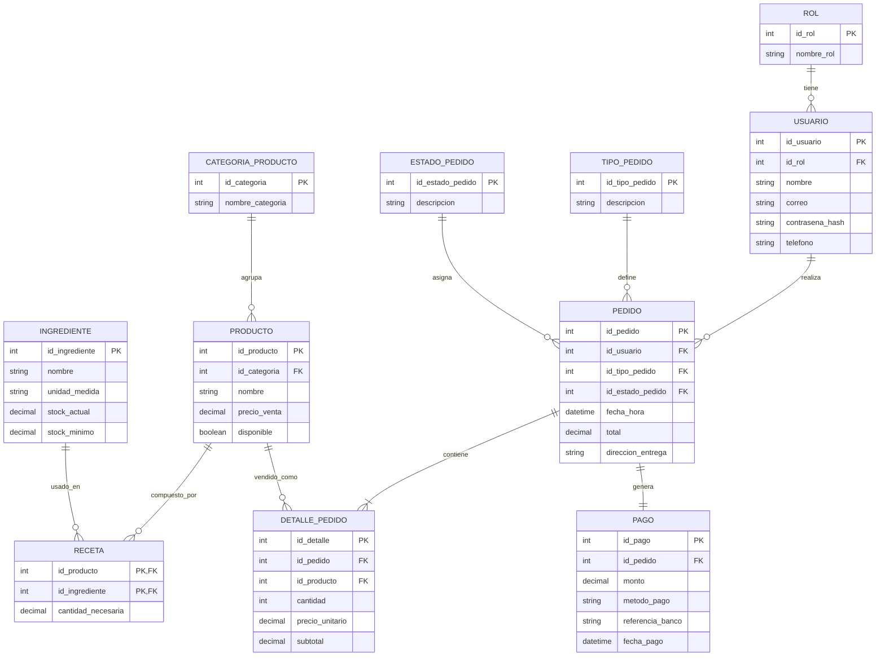

## Borrador 1


## Borrador 2

```mermaid
erDiagram
    ROL {
        int id_rol PK
        string nombre_rol
    }

    USUARIO {
        int id_usuario PK
        int id_rol FK
        int id_supervisor FK "Nullable (Jerarquía)"
        string nombres
        string apellidos
        string correo
        string contrasena_hash
        string telefono
    }

    CATEGORIA_PRODUCTO {
        int id_categoria PK
        string nombre_categoria
    }

    PRODUCTO {
        int id_producto PK
        int id_categoria FK
        int id_usuario_admin FK "Registra quién creó/modificó el producto"
        string nombre
        decimal precio_venta_actual
        boolean disponible
    }

    INGREDIENTE {
        int id_ingrediente PK
        string nombre
        string unidad_medida
        decimal stock_minimo
    }

    LOTE_INGREDIENTE {
        int id_lote PK
        int id_ingrediente FK
        int id_usuario_admin FK "Registra qué admin ingresó el lote"
        string codigo_lote
        datetime fecha_ingreso
        date fecha_vencimiento
        decimal cantidad_inicial
        decimal cantidad_disponible
    }

    RECETA {
        int id_receta PK
        int id_producto FK
        int id_ingrediente FK
        decimal cantidad_necesaria
    }

    TIPO_PEDIDO {
        int id_tipo_pedido PK
        string descripcion
    }

    ESTADO_PEDIDO {
        int id_estado_pedido PK
        string descripcion
    }

    PEDIDO {
        int id_pedido PK
        int id_usuario FK "Cliente que realiza el pedido"
        int id_tipo_pedido FK
        int id_estado_pedido FK
        datetime fecha_hora
        decimal total
        string direccion_entrega "Nullable"
    }

    DETALLE_PEDIDO {
        int id_detalle PK
        int id_pedido FK
        int id_producto FK
        int cantidad
        decimal precio_unitario_historico
    }

    METODO_PAGO {
        int id_metodo_pago PK
        string descripcion
    }

    PAGO {
        int id_pago PK
        int id_pedido FK
        int id_metodo_pago FK
        int id_usuario_admin FK "Nullable: Admin que valida el pago manual"
        decimal monto
        string referencia_banco "Nullable"
        datetime fecha_pago
    }

    FACTURA {
        int id_factura PK
        int id_pedido FK
        datetime fecha_emision
        string ruc_cedula_cliente
        string razon_social
        decimal subtotal_facturado
        decimal impuestos_facturados
        decimal total_facturado
    }

    ESTADO_ORDEN {
        int id_estado_orden PK
        string descripcion
    }

    ORDEN_SALIDA {
        int id_orden_salida PK
        int id_pedido FK
        int id_usuario_despacha FK "Empleado que despacha"
        int id_estado_orden FK
        datetime fecha_despacho "Nullable"
    }

    %% Relaciones y Cardinalidades
    ROL ||--o{ USUARIO : "tiene"
    USUARIO |o--o{ USUARIO : "reporta_a_supervisor"
    
    %% Relaciones de Administración/Auditoría
    USUARIO ||--o{ PRODUCTO : "administra_catalogo"
    USUARIO ||--o{ LOTE_INGREDIENTE : "registra_ingreso_lote"
    USUARIO |o--o{ PAGO : "valida_pago"

    %% Relaciones Operativas
    USUARIO ||--o{ PEDIDO : "realiza_compra"
    USUARIO ||--o{ ORDEN_SALIDA : "despacha"
    CATEGORIA_PRODUCTO ||--o{ PRODUCTO : "agrupa"
    PRODUCTO ||--o{ RECETA : "compuesto_por"
    INGREDIENTE ||--o{ RECETA : "usado_en"
    INGREDIENTE ||--o{ LOTE_INGREDIENTE : "almacenado_en"
    TIPO_PEDIDO ||--o{ PEDIDO : "define"
    ESTADO_PEDIDO ||--o{ PEDIDO : "asigna"
    PEDIDO ||--|{ DETALLE_PEDIDO : "contiene"
    PRODUCTO ||--o{ DETALLE_PEDIDO : "vendido_como"
    METODO_PAGO ||--o{ PAGO : "utiliza"
    PEDIDO ||--|| PAGO : "genera"
    PEDIDO ||--|| FACTURA : "emite"
    ESTADO_ORDEN ||--o{ ORDEN_SALIDA : "asigna"
    PEDIDO ||--|| ORDEN_SALIDA : "requiere"
```



## 100 Querys de consulta

```sql
-- ==========================================
-- 1. POBLACIÓN DE DATOS BASE (CATÁLOGOS) [1-10]
-- ==========================================
-- 1
INSERT INTO ROL (id_rol, nombre_rol) VALUES (1, 'Administrador');
-- 2
INSERT INTO ROL (id_rol, nombre_rol) VALUES (2, 'Cajero'), (3, 'Cocinero'), (4, 'Cliente');
-- 3
INSERT INTO CATEGORIA_PRODUCTO (id_categoria, nombre_categoria) VALUES (1, 'Hamburguesas'), (2, 'Bebidas');
-- 4
INSERT INTO TIPO_PEDIDO (id_tipo_pedido, descripcion) VALUES (1, 'Para Llevar'), (2, 'A Domicilio'), (3, 'En Local');
-- 5
INSERT INTO ESTADO_PEDIDO (id_estado_pedido, descripcion) VALUES (1, 'Pendiente'), (2, 'Preparando'), (3, 'Listo'), (4, 'Entregado');
-- 6
INSERT INTO METODO_PAGO (id_metodo_pago, descripcion) VALUES (1, 'Efectivo'), (2, 'Tarjeta de Crédito'), (3, 'Transferencia');
-- 7
INSERT INTO ESTADO_ORDEN (id_estado_orden, descripcion) VALUES (1, 'En Espera'), (2, 'Despachado');
-- 8
INSERT INTO INGREDIENTE (id_ingrediente, nombre, unidad_medida, stock_minimo) VALUES (1, 'Carne de Res', 'KG', 10.00);
-- 9
INSERT INTO INGREDIENTE (id_ingrediente, nombre, unidad_medida, stock_minimo) VALUES (2, 'Pan de Hamburguesa', 'Unidad', 50.00);
-- 10
INSERT INTO INGREDIENTE (id_ingrediente, nombre, unidad_medida, stock_minimo) VALUES (3, 'Tomate', 'KG', 5.00);

-- ==========================================
-- 2. INSERCIÓN DE USUARIOS Y PRODUCTOS (CON AUDITORÍA) [11-20]
-- ==========================================
-- 11 (Insertar Admin)
INSERT INTO USUARIO (id_usuario, id_rol, id_supervisor, nombres, apellidos, correo, contrasena_hash, telefono) 
VALUES (1, 1, NULL, 'Juan', 'Perez', 'admin@mail.com', 'hash123', '0999999991');
-- 12 (Insertar Empleado reportando al Admin)
INSERT INTO USUARIO (id_usuario, id_rol, id_supervisor, nombres, apellidos, correo, contrasena_hash, telefono) 
VALUES (2, 2, 1, 'Maria', 'Gomez', 'cajero@mail.com', 'hash123', '0999999992');
-- 13 (Insertar Cliente)
INSERT INTO USUARIO (id_usuario, id_rol, id_supervisor, nombres, apellidos, correo, contrasena_hash, telefono) 
VALUES (3, 4, NULL, 'Carlos', 'Ruiz', 'cliente@mail.com', 'hash123', '0999999993');
-- 14 (Insertar Producto por el Admin)
INSERT INTO PRODUCTO (id_producto, id_categoria, id_usuario_admin, nombre, precio_venta_actual, disponible) 
VALUES (1, 1, 1, 'Hamburguesa Clásica', 5.50, TRUE);
-- 15 (Insertar Producto 2)
INSERT INTO PRODUCTO (id_producto, id_categoria, id_usuario_admin, nombre, precio_venta_actual, disponible) 
VALUES (2, 2, 1, 'Refresco de Cola', 1.50, TRUE);
-- 16 (Receta Hamburguesa - Carne)
INSERT INTO RECETA (id_receta, id_producto, id_ingrediente, cantidad_necesaria) VALUES (1, 1, 1, 0.20);
-- 17 (Receta Hamburguesa - Pan)
INSERT INTO RECETA (id_receta, id_producto, id_ingrediente, cantidad_necesaria) VALUES (2, 1, 2, 1.00);
-- 18 (Ingreso Lote de Carne - Registrado por Admin)
INSERT INTO LOTE_INGREDIENTE (id_lote, id_ingrediente, id_usuario_admin, codigo_lote, fecha_ingreso, fecha_vencimiento, cantidad_inicial, cantidad_disponible) 
VALUES (1, 1, 1, 'L-CAR-001', '2023-10-01 10:00:00', '2023-10-15', 20.00, 20.00);
-- 19 (Ingreso Lote de Pan)
INSERT INTO LOTE_INGREDIENTE (id_lote, id_ingrediente, id_usuario_admin, codigo_lote, fecha_ingreso, fecha_vencimiento, cantidad_inicial, cantidad_disponible) 
VALUES (2, 2, 1, 'L-PAN-001', '2023-10-02 08:00:00', '2023-10-10', 100.00, 100.00);
-- 20 (Segundo Lote de Carne - Para probar FIFO)
INSERT INTO LOTE_INGREDIENTE (id_lote, id_ingrediente, id_usuario_admin, codigo_lote, fecha_ingreso, fecha_vencimiento, cantidad_inicial, cantidad_disponible) 
VALUES (3, 1, 1, 'L-CAR-002', '2023-10-05 10:00:00', '2023-10-20', 15.00, 15.00);

-- ==========================================
-- 3. TRANSACCIONES: PEDIDOS, DETALLES Y PAGOS [21-30]
-- ==========================================
-- 21 (Crear Pedido)
INSERT INTO PEDIDO (id_pedido, id_usuario, id_tipo_pedido, id_estado_pedido, fecha_hora, total, direccion_entrega) 
VALUES (1, 3, 2, 1, '2023-10-08 13:00:00', 12.50, 'Av. Principal 123');
-- 22 (Detalle Pedido - 2 Hamburguesas)
INSERT INTO DETALLE_PEDIDO (id_detalle, id_pedido, id_producto, cantidad, precio_unitario_historico) 
VALUES (1, 1, 1, 2, 5.50);
-- 23 (Detalle Pedido - 1 Refresco)
INSERT INTO DETALLE_PEDIDO (id_detalle, id_pedido, id_producto, cantidad, precio_unitario_historico) 
VALUES (2, 1, 2, 1, 1.50);
-- 24 (Registrar Pago)
INSERT INTO PAGO (id_pago, id_pedido, id_metodo_pago, id_usuario_admin, monto, referencia_banco, fecha_pago) 
VALUES (1, 1, 3, 2, 12.50, 'REF987654', '2023-10-08 13:05:00');
-- 25 (Emitir Factura)
INSERT INTO FACTURA (id_factura, id_pedido, fecha_emision, ruc_cedula_cliente, razon_social, subtotal_facturado, impuestos_facturados, total_facturado) 
VALUES (1, 1, '2023-10-08 13:06:00', '0999999999', 'Carlos Ruiz', 11.16, 1.34, 12.50);
-- 26 (Generar Orden Salida)
INSERT INTO ORDEN_SALIDA (id_orden_salida, id_pedido, id_usuario_despacha, id_estado_orden, fecha_despacho) 
VALUES (1, 1, 2, 1, NULL);
-- 27 (Otro Pedido en Local)
INSERT INTO PEDIDO (id_pedido, id_usuario, id_tipo_pedido, id_estado_pedido, fecha_hora, total, direccion_entrega) 
VALUES (2, 3, 3, 4, '2023-10-09 14:00:00', 5.50, NULL);
-- 28 (Detalle de Pedido 2)
INSERT INTO DETALLE_PEDIDO (id_detalle, id_pedido, id_producto, cantidad, precio_unitario_historico) VALUES (3, 2, 1, 1, 5.50);
-- 29 (Pago en efectivo validado por cajero)
INSERT INTO PAGO (id_pago, id_pedido, id_metodo_pago, id_usuario_admin, monto, referencia_banco, fecha_pago) 
VALUES (2, 2, 1, 2, 5.50, NULL, '2023-10-09 14:01:00');
-- 30 (Factura Pedido 2)
INSERT INTO FACTURA (id_factura, id_pedido, fecha_emision, ruc_cedula_cliente, razon_social, subtotal_facturado, impuestos_facturados, total_facturado) 
VALUES (2, 2, '2023-10-09 14:02:00', '9999999999', 'Consumidor Final', 4.91, 0.59, 5.50);

-- ==========================================
-- 4. ACTUALIZACIONES (UPDATES) [31-40]
-- ==========================================
-- 31 Actualizar precio de producto (el histórico en detalle no cambiará)
UPDATE PRODUCTO SET precio_venta_actual = 6.00 WHERE id_producto = 1;
-- 32 Cambiar estado del pedido a Preparando
UPDATE PEDIDO SET id_estado_pedido = 2 WHERE id_pedido = 1;
-- 33 Cambiar estado del pedido a Entregado
UPDATE PEDIDO SET id_estado_pedido = 4 WHERE id_pedido = 1;
-- 34 Actualizar orden de salida a Despachado y asignar fecha
UPDATE ORDEN_SALIDA SET id_estado_orden = 2, fecha_despacho = '2023-10-08 13:20:00' WHERE id_orden_salida = 1;
-- 35 Descontar stock lote de carne (Simulación FIFO 2 hamburguesas = 0.40 KG)
UPDATE LOTE_INGREDIENTE SET cantidad_disponible = cantidad_disponible - 0.40 WHERE id_lote = 1;
-- 36 Descontar stock lote de pan (2 panes)
UPDATE LOTE_INGREDIENTE SET cantidad_disponible = cantidad_disponible - 2 WHERE id_lote = 2;
-- 37 Actualizar correo de cliente
UPDATE USUARIO SET correo = 'carlos.nuevo@mail.com' WHERE id_usuario = 3;
-- 38 Deshabilitar un producto temporalmente
UPDATE PRODUCTO SET disponible = FALSE WHERE id_producto = 2;
-- 39 Reasignar cajero a otro supervisor
UPDATE USUARIO SET id_supervisor = NULL WHERE id_usuario = 2;
-- 40 Ajustar stock inicial por merma (Lote 3)
UPDATE LOTE_INGREDIENTE SET cantidad_disponible = cantidad_disponible - 1.00 WHERE id_lote = 3;

-- ==========================================
-- 5. ELIMINACIONES DE PRUEBA (DELETES) [41-45]
-- ==========================================
-- 41 Insertar producto temporal para borrar
INSERT INTO PRODUCTO (id_producto, id_categoria, id_usuario_admin, nombre, precio_venta_actual, disponible) VALUES (99, 2, 1, 'Agua', 1.00, TRUE);
-- 42 Borrar producto temporal (porque no tiene dependencias)
DELETE FROM PRODUCTO WHERE id_producto = 99;
-- 43 Insertar categoría temporal
INSERT INTO CATEGORIA_PRODUCTO (id_categoria, nombre_categoria) VALUES (99, 'Postres');
-- 44 Eliminar categoría temporal
DELETE FROM CATEGORIA_PRODUCTO WHERE id_categoria = 99;
-- 45 Borrar una receta mal ingresada temporal
INSERT INTO RECETA (id_receta, id_producto, id_ingrediente, cantidad_necesaria) VALUES (99, 2, 3, 0.5);
DELETE FROM RECETA WHERE id_receta = 99;

-- ==========================================
-- 6. CONSULTAS BÁSICAS (SELECTS) [46-55]
-- ==========================================
-- 46 Ver todos los usuarios activos
SELECT * FROM USUARIO;
-- 47 Ver productos disponibles
SELECT nombre, precio_venta_actual FROM PRODUCTO WHERE disponible = TRUE;
-- 48 Ver stock de lotes
SELECT codigo_lote, cantidad_disponible, fecha_vencimiento FROM LOTE_INGREDIENTE;
-- 49 Ver pedidos mayores a $10
SELECT id_pedido, fecha_hora, total FROM PEDIDO WHERE total > 10.00;
-- 50 Consultar facturas emitidas hoy (ejemplo fijo)
SELECT * FROM FACTURA WHERE fecha_emision >= '2023-10-08';
-- 51 Buscar cliente por correo
SELECT nombres, apellidos FROM USUARIO WHERE correo = 'carlos.nuevo@mail.com';
-- 52 Ver lotes próximos a vencer
SELECT codigo_lote, fecha_vencimiento FROM LOTE_INGREDIENTE WHERE fecha_vencimiento < '2023-10-15';
-- 53 Consultar métodos de pago
SELECT * FROM METODO_PAGO;
-- 54 Ver órdenes de salida pendientes
SELECT * FROM ORDEN_SALIDA WHERE id_estado_orden = 1;
-- 55 Buscar ingredientes por unidad de medida
SELECT nombre FROM INGREDIENTE WHERE unidad_medida = 'KG';

-- ==========================================
-- 7. CONSULTAS CON RELACIONES (JOINS) [56-75]
-- ==========================================
-- 56 Pedidos con nombre de cliente
SELECT p.id_pedido, u.nombres, u.apellidos, p.total 
FROM PEDIDO p JOIN USUARIO u ON p.id_usuario = u.id_usuario;
-- 57 Productos con su categoría
SELECT pr.nombre, c.nombre_categoria, pr.precio_venta_actual 
FROM PRODUCTO pr JOIN CATEGORIA_PRODUCTO c ON pr.id_categoria = c.id_categoria;
-- 58 Receta completa de un producto
SELECT pr.nombre as Producto, i.nombre as Ingrediente, r.cantidad_necesaria, i.unidad_medida 
FROM RECETA r JOIN PRODUCTO pr ON r.id_producto = pr.id_producto JOIN INGREDIENTE i ON r.id_ingrediente = i.id_ingrediente;
-- 59 Lotes con su respectivo ingrediente
SELECT l.codigo_lote, i.nombre, l.cantidad_disponible 
FROM LOTE_INGREDIENTE l JOIN INGREDIENTE i ON l.id_ingrediente = i.id_ingrediente;
-- 60 Detalles de un pedido específico
SELECT d.cantidad, pr.nombre, d.precio_unitario_historico 
FROM DETALLE_PEDIDO d JOIN PRODUCTO pr ON d.id_producto = pr.id_producto WHERE d.id_pedido = 1;
-- 61 Pagos con su método y responsable
SELECT pa.monto, m.descripcion as Metodo, u.nombres as Cajero 
FROM PAGO pa JOIN METODO_PAGO m ON pa.id_metodo_pago = m.id_metodo_pago LEFT JOIN USUARIO u ON pa.id_usuario_admin = u.id_usuario;
-- 62 Factura de un pedido con datos de cliente
SELECT f.ruc_cedula_cliente, f.total_facturado, p.direccion_entrega 
FROM FACTURA f JOIN PEDIDO p ON f.id_pedido = p.id_pedido;
-- 63 Orden de salida con responsable
SELECT os.id_orden_salida, e.descripcion, u.nombres as Despachador 
FROM ORDEN_SALIDA os JOIN ESTADO_ORDEN e ON os.id_estado_orden = e.id_estado_orden LEFT JOIN USUARIO u ON os.id_usuario_despacha = u.id_usuario;
-- 64 Pedidos y su estado actual
SELECT p.id_pedido, ep.descripcion as Estado, p.fecha_hora 
FROM PEDIDO p JOIN ESTADO_PEDIDO ep ON p.id_estado_pedido = ep.id_estado_pedido;
-- 65 Tipos de pedido usados
SELECT tp.descripcion, p.id_pedido 
FROM PEDIDO p JOIN TIPO_PEDIDO tp ON p.id_tipo_pedido = tp.id_tipo_pedido;
-- 66 Ingredientes registrados por un admin específico
SELECT i.nombre, l.codigo_lote, u.nombres as Admin_Registro 
FROM LOTE_INGREDIENTE l JOIN INGREDIENTE i ON l.id_ingrediente = i.id_ingrediente JOIN USUARIO u ON l.id_usuario_admin = u.id_usuario;
-- 67 Productos creados/editados por un admin
SELECT p.nombre, u.nombres as Admin_Catalogo 
FROM PRODUCTO p JOIN USUARIO u ON p.id_usuario_admin = u.id_usuario;
-- 68 Usuarios con sus roles
SELECT u.nombres, u.apellidos, r.nombre_rol 
FROM USUARIO u JOIN ROL r ON u.id_rol = r.id_rol;
-- 69 Listar todo el menú disponible con categoría
SELECT c.nombre_categoria, p.nombre, p.precio_venta_actual 
FROM PRODUCTO p JOIN CATEGORIA_PRODUCTO c ON p.id_categoria = c.id_categoria WHERE p.disponible = TRUE;
-- 70 Compras realizadas por un cliente específico
SELECT p.id_pedido, p.total, ep.descripcion 
FROM PEDIDO p JOIN ESTADO_PEDIDO ep ON p.id_estado_pedido = ep.id_estado_pedido WHERE p.id_usuario = 3;
-- 71 Subtotal calculado al vuelo vs histórico (Auditoría)
SELECT dp.id_detalle, (dp.cantidad * dp.precio_unitario_historico) as Subtotal_Calculado FROM DETALLE_PEDIDO dp;
-- 72 Pagos vs Total del Pedido (Para encontrar descuadres)
SELECT p.id_pedido, p.total as Total_Pedido, pa.monto as Total_Pagado 
FROM PEDIDO p JOIN PAGO pa ON p.id_pedido = pa.id_pedido;
-- 73 Facturas y sus métodos de pago relacionados
SELECT f.id_factura, f.total_facturado, mp.descripcion 
FROM FACTURA f JOIN PAGO pa ON f.id_pedido = pa.id_pedido JOIN METODO_PAGO mp ON pa.id_metodo_pago = mp.id_metodo_pago;
-- 74 Ver qué producto pertenece a qué orden de salida
SELECT os.id_orden_salida, pr.nombre, dp.cantidad 
FROM ORDEN_SALIDA os JOIN PEDIDO p ON os.id_pedido = p.id_pedido JOIN DETALLE_PEDIDO dp ON p.id_pedido = dp.id_pedido JOIN PRODUCTO pr ON dp.id_producto = pr.id_producto;
-- 75 Clientes que solicitaron a Domicilio
SELECT DISTINCT u.nombres, p.direccion_entrega 
FROM USUARIO u JOIN PEDIDO p ON u.id_usuario = p.id_usuario JOIN TIPO_PEDIDO tp ON p.id_tipo_pedido = tp.id_tipo_pedido WHERE tp.descripcion = 'A Domicilio';

-- ==========================================
-- 8. AGREGACIONES, REPORTES Y ESTADÍSTICAS [76-85]
-- ==========================================
-- 76 Total de ventas por día
SELECT DATE(fecha_hora) as Dia, SUM(total) as Ingresos FROM PEDIDO GROUP BY DATE(fecha_hora);
-- 77 Cantidad de productos vendidos por categoría
SELECT c.nombre_categoria, SUM(dp.cantidad) as Total_Vendidos 
FROM DETALLE_PEDIDO dp JOIN PRODUCTO p ON dp.id_producto = p.id_producto JOIN CATEGORIA_PRODUCTO c ON p.id_categoria = c.id_categoria GROUP BY c.nombre_categoria;
-- 78 Total de ingredientes disponibles agrupados por ingrediente (Suma de lotes)
SELECT i.nombre, SUM(l.cantidad_disponible) as Stock_Total, i.unidad_medida 
FROM INGREDIENTE i JOIN LOTE_INGREDIENTE l ON i.id_ingrediente = l.id_ingrediente GROUP BY i.nombre, i.unidad_medida;
-- 79 Ingredientes que están por debajo del stock mínimo (Alerta de Reabastecimiento)
SELECT i.nombre, SUM(l.cantidad_disponible) as Stock_Total, i.stock_minimo 
FROM INGREDIENTE i JOIN LOTE_INGREDIENTE l ON i.id_ingrediente = l.id_ingrediente GROUP BY i.id_ingrediente, i.nombre, i.stock_minimo HAVING SUM(l.cantidad_disponible) <= i.stock_minimo;
-- 80 Promedio de gasto por cliente
SELECT u.nombres, AVG(p.total) as Promedio_Compra 
FROM USUARIO u JOIN PEDIDO p ON u.id_usuario = p.id_usuario GROUP BY u.id_usuario, u.nombres;
-- 81 Producto más vendido
SELECT pr.nombre, SUM(dp.cantidad) as Total_Ventas 
FROM DETALLE_PEDIDO dp JOIN PRODUCTO pr ON dp.id_producto = pr.id_producto GROUP BY pr.id_producto, pr.nombre ORDER BY Total_Ventas DESC;
-- 82 Monto recaudado por método de pago
SELECT mp.descripcion, SUM(pa.monto) as Total_Recaudado 
FROM PAGO pa JOIN METODO_PAGO mp ON pa.id_metodo_pago = mp.id_metodo_pago GROUP BY mp.descripcion;
-- 83 Conteo de pedidos por estado
SELECT ep.descripcion, COUNT(p.id_pedido) as Numero_Pedidos 
FROM PEDIDO p JOIN ESTADO_PEDIDO ep ON p.id_estado_pedido = ep.id_estado_pedido GROUP BY ep.descripcion;
-- 84 Total de impuestos generados
SELECT SUM(impuestos_facturados) as Total_Impuestos FROM FACTURA;
-- 85 Número de pedidos manejados por cada despachador
SELECT u.nombres, COUNT(os.id_orden_salida) as Ordenes_Despachadas 
FROM ORDEN_SALIDA os JOIN USUARIO u ON os.id_usuario_despacha = u.id_usuario GROUP BY u.nombres;

-- ==========================================
-- 9. LÓGICA FIFO Y VENCIMIENTOS [86-90]
-- ==========================================
-- 86 Obtener el lote más antiguo (FIFO) de carne con stock > 0 para descontar
SELECT id_lote, codigo_lote, cantidad_disponible 
FROM LOTE_INGREDIENTE WHERE id_ingrediente = 1 AND cantidad_disponible > 0 ORDER BY fecha_ingreso ASC LIMIT 1;
-- 87 Ver lotes caducados que aún tienen stock (Pérdida)
SELECT codigo_lote, fecha_vencimiento, cantidad_disponible 
FROM LOTE_INGREDIENTE WHERE fecha_vencimiento < CURRENT_DATE AND cantidad_disponible > 0;
-- 88 Porcentaje de merma/consumo por lote (Cantidad inicial vs disponible)
SELECT codigo_lote, ((cantidad_inicial - cantidad_disponible) / cantidad_inicial) * 100 as Porcentaje_Consumido FROM LOTE_INGREDIENTE;
-- 89 Proyección de consumo: Cuánto stock hay en el lote más antiguo vs el total
SELECT i.nombre, l.codigo_lote as Lote_Mas_Viejo, l.cantidad_disponible as Stock_Lote_Viejo, 
(SELECT SUM(cantidad_disponible) FROM LOTE_INGREDIENTE WHERE id_ingrediente = i.id_ingrediente) as Stock_Global 
FROM INGREDIENTE i JOIN LOTE_INGREDIENTE l ON i.id_ingrediente = l.id_ingrediente WHERE l.cantidad_disponible > 0 ORDER BY l.fecha_ingreso ASC;
-- 90 Contar cuántos lotes activos tiene cada ingrediente
SELECT i.nombre, COUNT(l.id_lote) as Cantidad_Lotes_Activos 
FROM INGREDIENTE i JOIN LOTE_INGREDIENTE l ON i.id_ingrediente = l.id_ingrediente WHERE l.cantidad_disponible > 0 GROUP BY i.nombre;

-- ==========================================
-- 10. JERARQUÍAS, AUDITORÍA Y VISTAS COMPLEJAS [91-100]
-- ==========================================
-- 91 Consultar quién es el supervisor de un empleado (Auto-Join)
SELECT emp.nombres as Empleado, sup.nombres as Supervisor 
FROM USUARIO emp JOIN USUARIO sup ON emp.id_supervisor = sup.id_usuario;
-- 92 Empleados que NO tienen supervisor (Alta Gerencia)
SELECT nombres, apellidos, correo FROM USUARIO WHERE id_supervisor IS NULL AND id_rol IN (1, 2, 3);
-- 93 Auditoría: Lotes registrados por X administrador
SELECT u.nombres as Admin, COUNT(l.id_lote) as Lotes_Registrados 
FROM LOTE_INGREDIENTE l JOIN USUARIO u ON l.id_usuario_admin = u.id_usuario GROUP BY u.nombres;
-- 94 Auditoría: Productos del catálogo modificados/creados por admin
SELECT p.nombre, u.nombres as Modificado_Por 
FROM PRODUCTO p JOIN USUARIO u ON p.id_usuario_admin = u.id_usuario;
-- 95 Validar que cada Pedido tiene una Factura
SELECT p.id_pedido, CASE WHEN f.id_factura IS NOT NULL THEN 'Facturado' ELSE 'Sin Factura' END as Estado_Factura 
FROM PEDIDO p LEFT JOIN FACTURA f ON p.id_pedido = f.id_pedido;
-- 96 Validar que cada Pedido Pagado generó una Orden de Salida
SELECT p.id_pedido, p.total, os.id_orden_salida as Nro_Orden 
FROM PEDIDO p JOIN PAGO pa ON p.id_pedido = pa.id_pedido LEFT JOIN ORDEN_SALIDA os ON p.id_pedido = os.id_pedido;
-- 97 Consultar toda la jerarquía de una sucursal (Gerente -> Empleados)
SELECT sup.nombres as Gerente, COUNT(emp.id_usuario) as Empleados_A_Cargo 
FROM USUARIO emp JOIN USUARIO sup ON emp.id_supervisor = sup.id_usuario GROUP BY sup.nombres;
-- 98 Pedidos que tomaron más de 30 minutos en entregarse (Desempeño)
SELECT p.id_pedido, p.fecha_hora as Pedido, os.fecha_despacho as Despacho 
FROM PEDIDO p JOIN ORDEN_SALIDA os ON p.id_pedido = os.id_pedido WHERE os.fecha_despacho > p.fecha_hora; -- Ajustar con TIMESTAMPDIFF según el motor SQL
-- 99 Auditoría de Cajeros: Total validado manualmente por cajero
SELECT u.nombres as Cajero, SUM(pa.monto) as Dinero_Recibido 
FROM PAGO pa JOIN USUARIO u ON pa.id_usuario_admin = u.id_usuario WHERE pa.id_metodo_pago = 1 GROUP BY u.nombres;
-- 100 Visión global 360 (Mega Join): Cliente, Producto, Pago, y Despacho
SELECT 
    p.id_pedido, c.nombres as Cliente, pr.nombre as Producto, 
    dp.cantidad, mp.descripcion as Metodo_Pago, eo.descripcion as Estado_Entrega 
FROM PEDIDO p 
JOIN USUARIO c ON p.id_usuario = c.id_usuario 
JOIN DETALLE_PEDIDO dp ON p.id_pedido = dp.id_pedido 
JOIN PRODUCTO pr ON dp.id_producto = pr.id_producto 
JOIN PAGO pa ON p.id_pedido = pa.id_pedido 
JOIN METODO_PAGO mp ON pa.id_metodo_pago = mp.id_metodo_pago 
JOIN ORDEN_SALIDA os ON p.id_pedido = os.id_pedido 
JOIN ESTADO_ORDEN eo ON os.id_estado_orden = eo.id_estado_orden;
```